<div align="center">


<br><br>

<a href="https://ataidev.github.io/Jetcargo/"><b>Открыть панель</b></a>
&nbsp;&nbsp;·&nbsp;&nbsp;
<a href="docs/DEVELOPMENT.md"><b>Документация</b></a>

<br><br>


<br>

<p>Рабочее место карго-компании: заказы, приём сканером, склад, выдача с оплатой, партии и прибыль —<br>
в одном интерфейсе, на компьютере и на телефоне.</p>

</div>

<br>

<table>
  <tr>
    <td width="33%" valign="top"><b>Заказы</b><br><sub>Заказ за минуту, импорт из Excel, поиск по коду и телефону</sub></td>
    <td width="33%" valign="top"><b>Приём</b><br><sub>Сканер, партии и накладные из Китая</sub></td>
    <td width="33%" valign="top"><b>Выдача</b><br><sub>С оплатой наличными или переводом, долги считаются сами</sub></td>
  </tr>
  <tr>
    <td valign="top"><b>Клиенты</b><br><sub>История заказов, оплаты, долги и уведомления</sub></td>
    <td valign="top"><b>Финансы</b><br><sub>Выручка, прибыль и расходы по партиям</sub></td>
    <td valign="top"><b>Журнал</b><br><sub>Кто, что и когда сделал — по каждому действию</sub></td>
  </tr>
</table>

<br>

<h2 align="center">Экраны</h2>

<table>
  <tr>
    <td width="50%">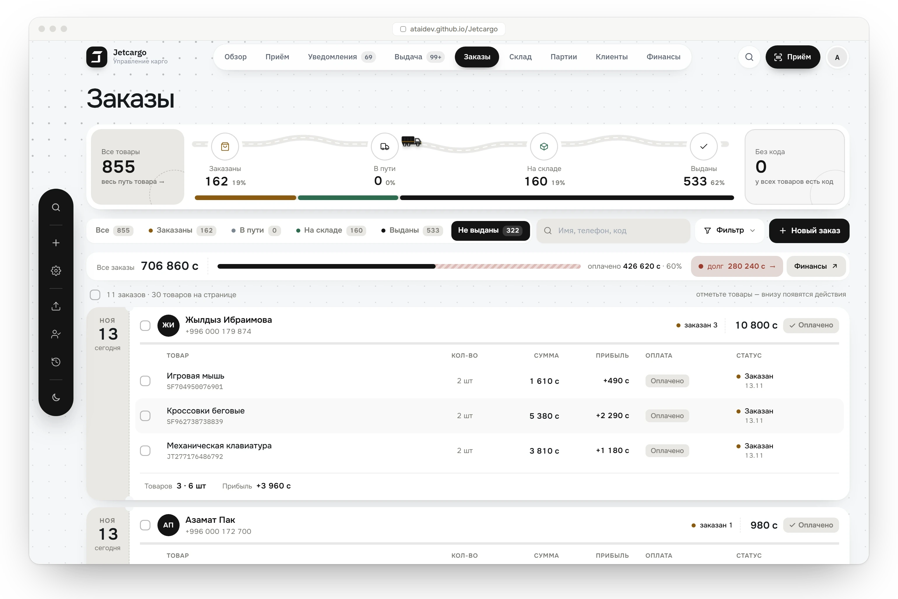<p align="center"><sub>Заказы</sub></p></td>
    <td width="50%">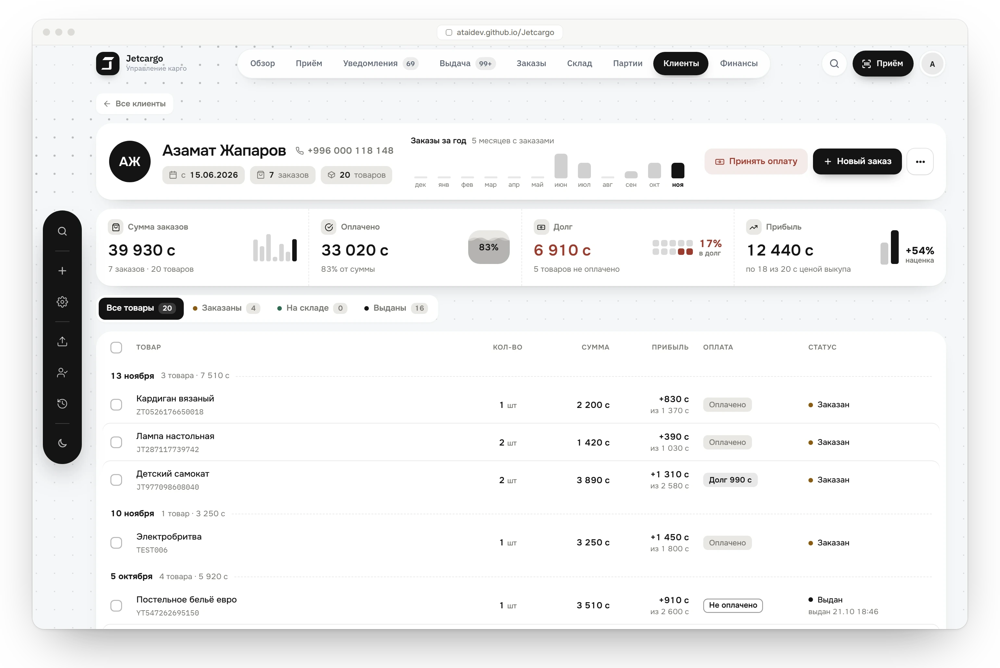<p align="center"><sub>Клиент</sub></p></td>
  </tr>
  <tr>
    <td>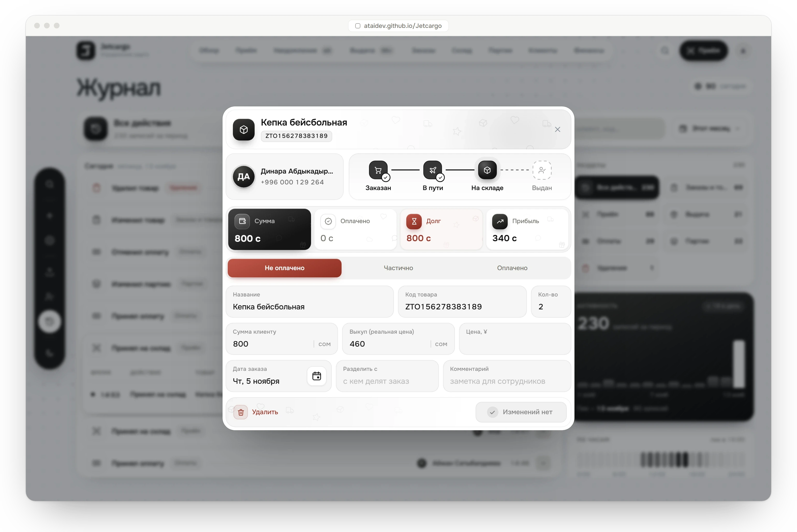<p align="center"><sub>Карточка товара</sub></p></td>
    <td>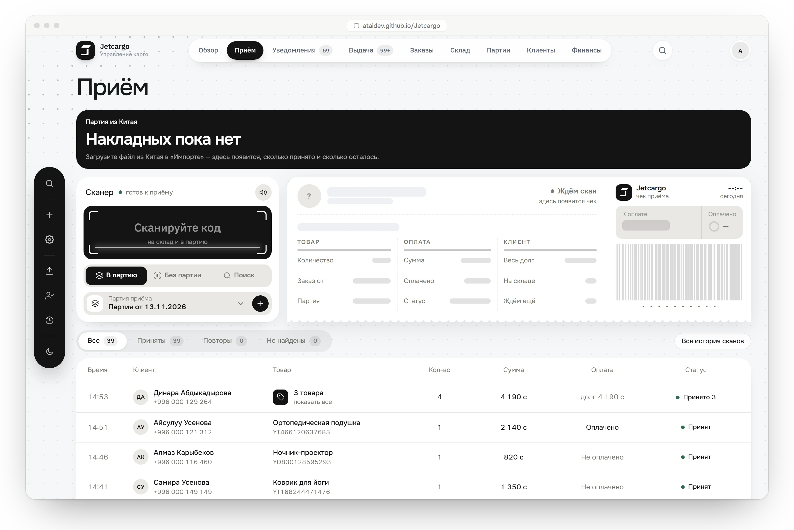<p align="center"><sub>Приём</sub></p></td>
  </tr>
  <tr>
    <td>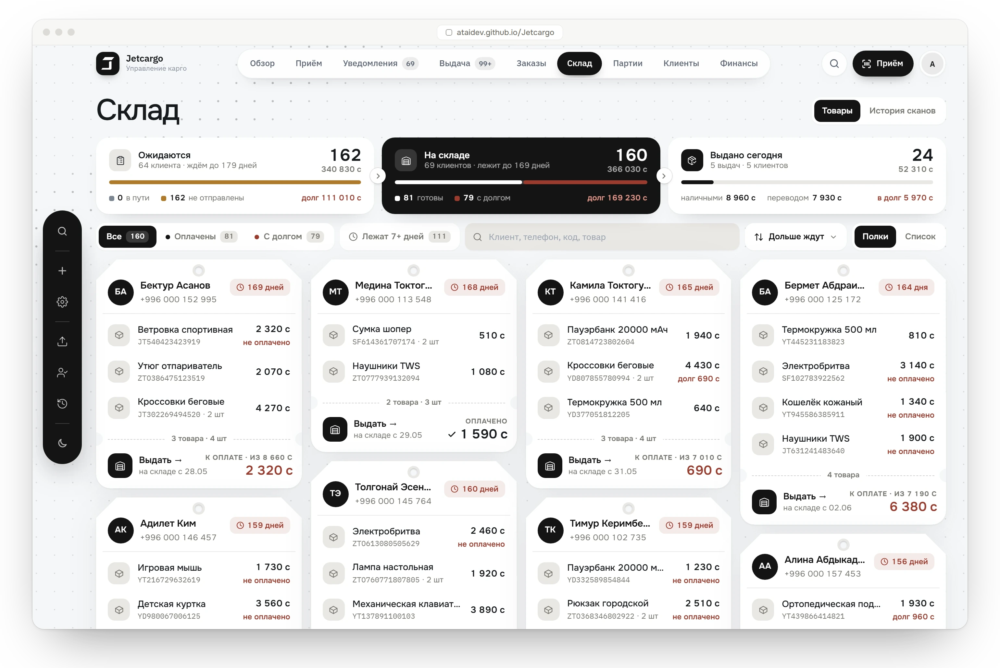<p align="center"><sub>Склад</sub></p></td>
    <td>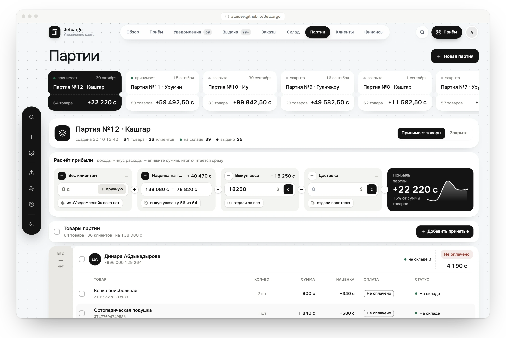<p align="center"><sub>Партии</sub></p></td>
  </tr>
  <tr>
    <td>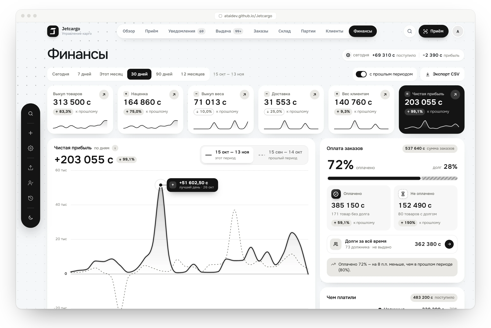<p align="center"><sub>Финансы</sub></p></td>
    <td>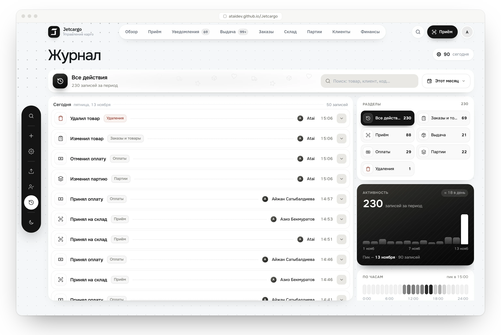<p align="center"><sub>Журнал</sub></p></td>
  </tr>
  <tr>
    <td>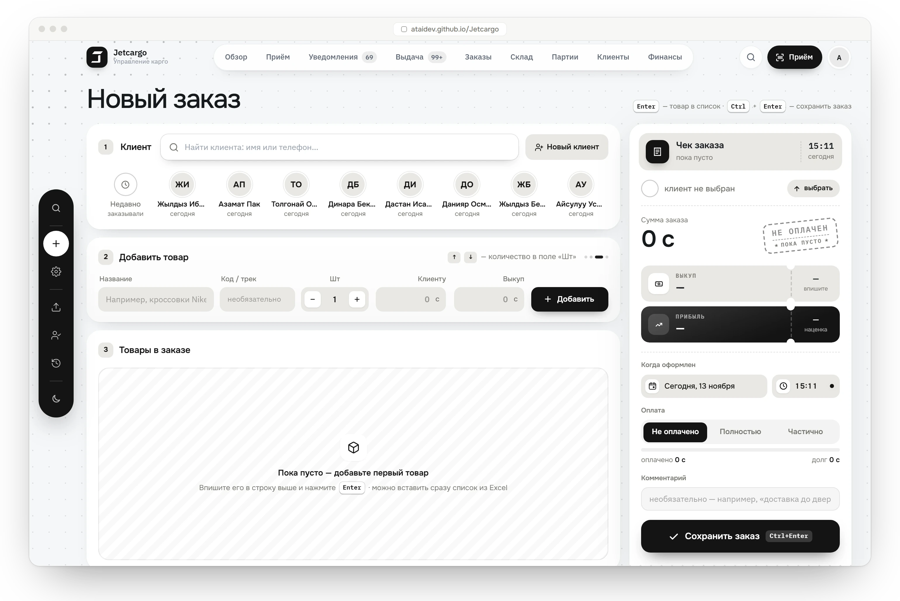<p align="center"><sub>Новый заказ</sub></p></td>
    <td>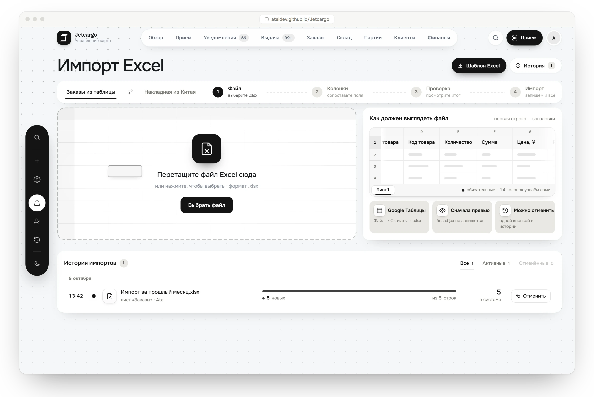<p align="center"><sub>Импорт</sub></p></td>
  </tr>
  <tr>
    <td>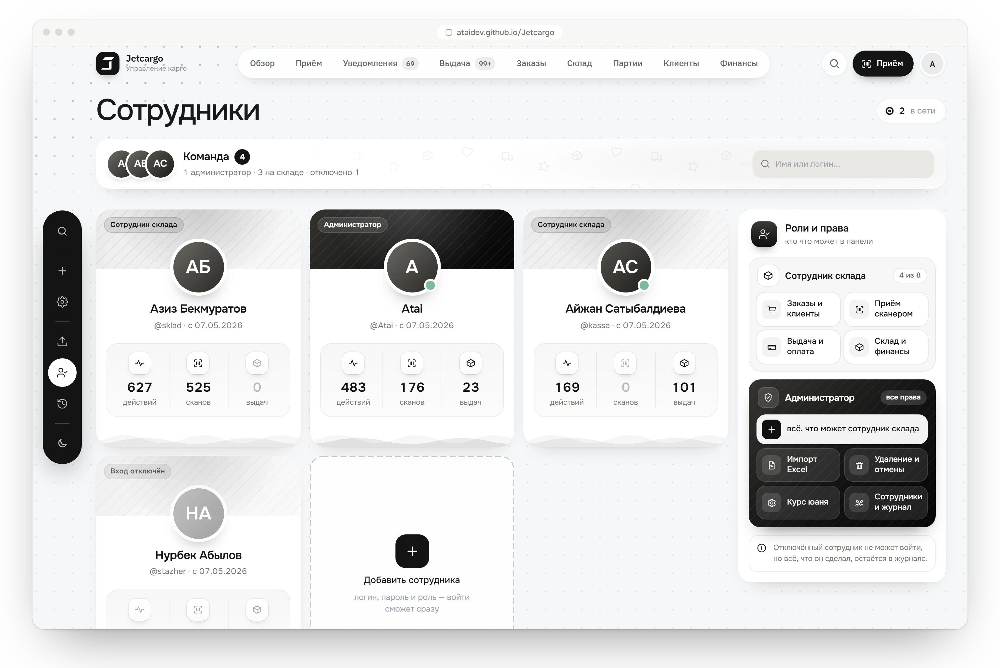<p align="center"><sub>Сотрудники</sub></p></td>
    <td>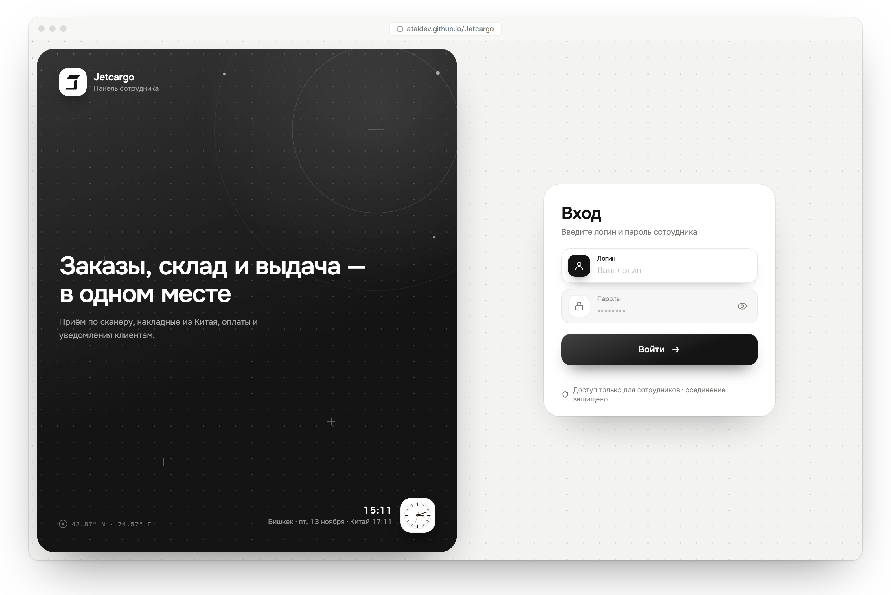<p align="center"><sub>Вход</sub></p></td>
  </tr>
</table>

<br>

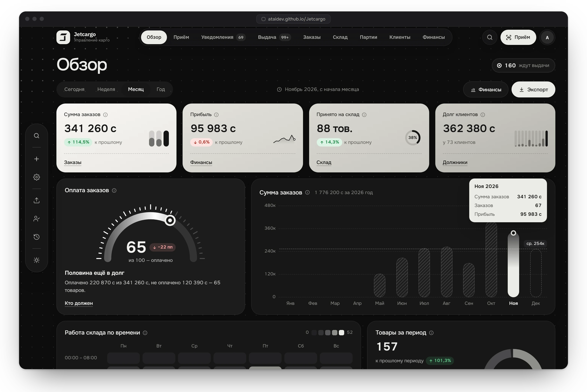
<p align="center"><sub>Тёмная тема</sub></p>

<br>

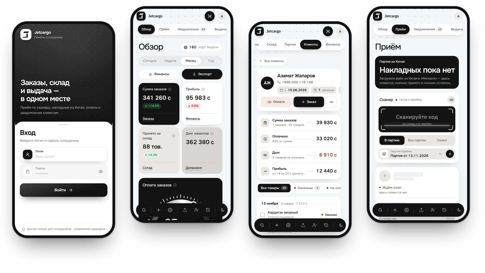
<p align="center"><sub>Мобильная версия — принимать и выдавать товар можно прямо на складе</sub></p>

<br>

<h2 align="center">Стек</h2>

<p align="center">
<b>Интерфейс</b> — React · TypeScript · Vite<br>
<b>Сервер</b> — Node.js · Express · SQLite<br>
<b>Инфраструктура</b> — GitHub Pages · Render · Docker · Litestream · Backblaze B2
</p>

<br>

<h2 align="center">Быстрый старт</h2>

```bash
cp server/.env.example server/.env   # JWT_SECRET, ADMIN_LOGIN, ADMIN_PASSWORD
npm run dev                          # backend и панель на тестовых данных
```

<p align="center">Панель откроется на <code>localhost:5173/admin</code> · нужен Node.js 24<br>
Облако, API, структура проекта и формулы — в <a href="docs/DEVELOPMENT.md"><b>документации</b></a></p>

<br>

<div align="center">
<sub>На скриншотах вымышленные данные · Сделано в Кыргызстане · © 2026 Jetcargo</sub>
</div>
